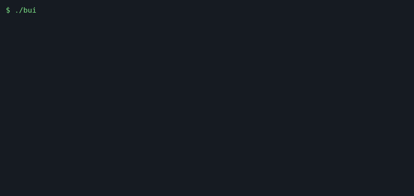

# adsb-aircraft-tracker

Decode 1090 MHz ADS-B straight from RTL-SDR IQ samples (or hex frames) into a live aircraft table, JSON and an HTML map - modern C++17, no dependencies.

[](https://github.com/bekirhankarakurt/adsb-aircraft-tracker/actions/workflows/ci.yml)
[](https://github.com/bekirhankarakurt/adsb-aircraft-tracker/actions/workflows/codeql.yml)
[](https://bekirhankarakurt.github.io/adsb-aircraft-tracker/coverage/)
[](https://github.com/bekirhankarakurt/adsb-aircraft-tracker/releases/latest)
[](LICENSE)
[](https://en.cppreference.com/w/cpp/17)
[](https://github.com/bekirhankarakurt/adsb-aircraft-tracker#requirements)



**Documentation:** [API reference and coverage report](https://bekirhankarakurt.github.io/adsb-aircraft-tracker/) | [Changelog](CHANGELOG.md) | [Contributing](CONTRIBUTING.md)

## Why / what

- **Whole receive chain from scratch**: preamble detection, PPM demodulation, CRC-24, DF17 decoding, CPR, tracking - no `libusb`, no `librtlsdr`, no third-party code.
- **CRC-24 with single-bit error correction**: weak frames are repaired instead of dropped (see the `8 corrected` in the demo).
- **Full DF17 position pipeline**: identification, airborne position (global even/odd and local CPR decoding), barometric altitude, ground/air speed, heading, vertical rate.
- **Hardware optional**: reads captures, `rtl_sdr` pipes, and `dump1090 --raw` style hex lines; the bundled simulator generates reproducible IQ so everything builds and is tested without a dongle.
- **Engineering hygiene**: RAII, no raw `new`/`delete`, zero warnings under `-Wall -Wextra -Wpedantic -Wshadow -Wconversion`, CI on GCC, Clang and ASan/UBSan.

## Demo

Real output from `adsb-tracker samples/sample.iq` (0.03 s of IQ, 60 frames, 8 of them with a flipped bit):

```text
ICAO   CALLSIGN ALT(ft)    SPD  HDG     VS       LAT        LON  MSGS SEEN(s)
4BA8F2 THY4KL      8400    250   75  +1472   41.2048    28.7738    20     0.0
4BB3A7 TKJ77      21525    320  150  -1792   41.4295    28.2158    20     0.0
4BC1D5 PGT2312    36000    440  270     +0   40.9000    29.3570    20     0.0
51000 samples (0.03 s): 52 valid, 8 corrected, 0 rejected
```

With `-v`, every decoded message is printed (`adsb-tracker -v -q samples/reference.hex`):

```text
[   0.0000] 4840D6 IDENT    KLM1023 (A0)
[   0.0000] 40621D POSITION even alt=38000 cpr=(93000,51372)
[   0.0000] 40621D POSITION odd  alt=38000 cpr=(74158,50194)
[   0.0000] 485020 VELOCITY gs=159 hdg=182.9 vs=-832
[   0.0000] A05F21 VELOCITY tas=375 hdg=244.0 vs=-2304
```

Without error correction (`--no-fix`) the same file yields `52 valid, 0 corrected, 8 rejected`.

## Quick start (60 seconds)

```bash
git clone https://github.com/bekirhankarakurt/adsb-aircraft-tracker.git
cd adsb-aircraft-tracker
cmake -S . -B build && cmake --build build -j
ctest --test-dir build --output-on-failure
./build/adsb-tracker samples/sample.iq --html map.html
```

Open `map.html` in a browser for the aircraft plot.

## Requirements

| Item | Needed | Notes |
|---|---|---|
| C++ compiler | GCC >= 9 or Clang >= 10 | C++17; CI uses the Ubuntu runner defaults |
| CMake | >= 3.16 | |
| OS | Linux | developed and CI-tested on Linux; the code is portable POSIX C++ |
| RTL-SDR + `rtl_sdr` | optional | only for live reception at 1090 MHz |

### Build options

| CMake option | Default | Effect |
|---|---|---|
| `CMAKE_BUILD_TYPE` | `Release` | standard CMake build type |
| `ADSB_BUILD_TESTS` | `ON` | build `adsb_tests` and register CTest cases |
| `ADSB_WARNINGS_AS_ERRORS` | `OFF` | add `-Werror` (CI sets it) |
| `ADSB_SANITIZE` | `OFF` | build with AddressSanitizer + UndefinedBehaviorSanitizer |

## Usage

`adsb-tracker [options] [FILE|-]` - `-` (the default) reads stdin.

| Option | Description |
|---|---|
| `-f, --format iq\|hex` | input format; default is by extension (`.hex`/`.txt` = hex, otherwise IQ) |
| `--ref LAT,LON` | receiver position; lets a single CPR frame be decoded (aircraft within ~180 NM) |
| `--json FILE` | write the aircraft snapshot as JSON (`-` = stdout) |
| `--html FILE` | write a self-contained map page |
| `--live` | refresh the table (and `--json`/`--html` files) once per second while reading |
| `--ttl SECONDS` | in `--live` mode, drop aircraft silent for this long (default 60) |
| `--no-fix` | disable single-bit error correction |
| `-v, --verbose` | print every decoded message |
| `-q, --quiet` | do not print the table |
| `--version`, `-h` | version / help |

Statistics go to stderr, so stdout stays clean for `--json -`. Exit codes: `0` ok, `1` I/O error, `2` usage error.

`adsb-sim --out FILE [--format iq|hex] [--cycles N] [--corrupt N] [--seed N] [--noise A]` writes the deterministic 3-aircraft scenario used for the samples.

### Recipes

**1. Live reception with an RTL-SDR** (needs hardware; the pipe path is exercised in tests with the simulator):

```bash
rtl_sdr -f 1090000000 -s 2000000 -g 40 - | ./build/adsb-tracker --live -f iq - --ref 41.0,29.0
```

**2. Live map served over HTTP** - the page polls `aircraft.json` once per second:

```bash
mkdir -p web && rtl_sdr -f 1090000000 -s 2000000 -g 40 - | \
  ./build/adsb-tracker --live -q -f iq - --json web/aircraft.json --html web/index.html &
python3 -m http.server 8080 --directory web
```

**3. Replay a recording and filter the JSON** (try it now):

```bash
./build/adsb-tracker -q --json - samples/sample.iq | python3 -c \
  "import json,sys; print([a['callsign'] for a in json.load(sys.stdin)['aircraft'] if a['alt_ft'] > 20000])"
# ['TKJ77', 'PGT2312']
```

**4. Consume hex frames from another decoder** (`dump1090 --raw`, or any `*HEX;` source):

```bash
dump1090 --raw | ./build/adsb-tracker -f hex --live -
./build/adsb-tracker -v samples/reference.hex
```

**5. Generate your own test captures, with corruption and noise:**

```bash
./build/adsb-sim -o test.iq --cycles 20 --corrupt 4 --noise 20 --seed 7
./build/adsb-tracker test.iq
```

## Architecture

```text
 rtl_sdr / file ──► Demodulator ──┐
 (8-bit IQ, 2 Msps)  magnitude,   │   RawFrame (112 bit, time)    ┌──► table  (stdout)
                     preamble,    ├──► decodeMessage ──► Tracker ─┼──► JSON   (--json)
                     PPM bits,    │    DF17 ME fields    per ICAO,└──► HTML   (--html)
                     CRC-24 fix   │                      CPR pairing
 hex lines ───────────────────────┘
 (*HEX; @TS+HEX; HEX)
```

| Decision | Trade-off |
|---|---|
| Fixed 2 Msps, one sample per half-bit | Matches the common `rtl_sdr -s 2000000` pipe and keeps the demodulator simple; no oversampling means slightly less sensitivity than 2.4 Msps decoders |
| Preamble match at every sample offset | Handles unknown phase alignment without a clock-recovery loop, at the cost of re-checking each sample |
| Only DF17 is accepted | Its CRC is self-contained, so integrity is verifiable without a ground-truth ICAO list; DF11/DF4/DF5 need interrogator-code handling |
| Single-bit correction only | Multi-bit repair multiplies false-positive frames on noise; the demodulator drops what it cannot prove |
| Streaming demodulator with carry-over | Any chunk size works (pipes, files); costs a small tail buffer |
| Tracker is time-driven by frame time | Replays are deterministic: IQ time comes from the sample clock, hex time from `@` stamps or wall clock |
| HTML map is a dependency-free canvas | Works offline and needs no tile server, but draws no basemap |

## Data formats

### Hex input

| Form | Example |
|---|---|
| AVR raw | `*8D4840D6202CC371C32CE0576098;` |
| AVR with 12 MHz timestamp | `@000000B71B008D4840D6202CC371C32CE0576098;` |
| Bare hex | `8D4840D6202CC371C32CE0576098` |

Blank lines and lines starting with `#` are ignored; frames must be 112 bits.

### DF17 fields decoded

| Type code | Content | Decoded fields |
|---|---|---|
| 1-4 | Identification | callsign, category (e.g. `A3`) |
| 9-18 | Airborne position (baro) | altitude (Q-bit, 25 ft), CPR lat/lon, even/odd flag |
| 20-22 | Airborne position (GNSS) | CPR lat/lon, even/odd flag |
| 19 (sub 1-2) | Ground speed | speed, track, vertical rate |
| 19 (sub 3-4) | Airspeed | IAS/TAS, heading, vertical rate |

### JSON output

```json
{"icao":"4BA8F2","callsign":"THY4KL","category":"A3","alt_ft":8400,"lat":41.20478,"lon":28.77376,
 "speed_kt":249.6,"speed_type":"gs","heading":74.9,"vrate_fpm":1472,"messages":20,"seen_s":0.0}
```

Unknown values are `null`. `speed_type` is `gs`, `ias` or `tas`.

## Testing

```bash
ctest --test-dir build --output-on-failure   # 12 tests
./build/tests/adsb_tests crc                 # run one unit suite directly
```

| Suite | Covers |
|---|---|
| `crc` | zero remainder, parity sealing, all 112 single-bit repairs, double-bit rejection |
| `message` | published reference frames, encoder round trip |
| `cpr` | zone table, published even/odd pair, global/local agreement, zone-boundary rejection |
| `demod` | exact frame recovery, 1-byte chunks, timestamps, bit repair, heavy noise, pure noise |
| `input`, `tracker`, `output` | hex dialects, CPR pairing/pruning, JSON escaping, table, HTML |
| `samples` | replay of `sample.iq`, `sample.hex`, `reference.hex` |
| `cli.*` | end-to-end runs of the binary including stdin and bad options |

Static analysis (cppcheck, clang-tidy), coverage and Doxygen run in CI; see [CONTRIBUTING.md](CONTRIBUTING.md) for the local commands.

Sanitizer run: `cmake -S . -B build-san -DADSB_SANITIZE=ON && cmake --build build-san -j && ctest --test-dir build-san`.

## Troubleshooting / FAQ

**No aircraft appear with a real dongle.** Use `-s 2000000` exactly; any other rate breaks the 2 Msps timing assumption. Raise gain (`-g 40`), use a 1090 MHz antenna and keep it near a window.

**Aircraft show up without a position.** A global fix needs one even and one odd frame within 10 s. Pass `--ref LAT,LON` to decode single frames near your location.

**Why is the altitude `-`?** Only Q-bit (25 ft) altitude is decoded; Gillham-coded altitude is not.

**What does `rejected` mean?** A preamble plus DF17 header that failed the CRC and could not be repaired with one flipped bit - usually noise.

**Can I use dump1090 binary Beast output?** Not yet; text hex lines only (see roadmap).

## Project layout

```text
.
├── CMakeLists.txt          build options, targets, install rules
├── include/adsb/           public headers
│   ├── crc.hpp             CRC-24, parity sealing, single-bit correction
│   ├── demod.hpp           streaming IQ -> frames (preamble, PPM)
│   ├── input.hpp           hex line parser, IQ/hex stream readers
│   ├── message.hpp         DF17 message types and decoder
│   ├── cpr.hpp             CPR encode, global and local decode
│   ├── tracker.hpp         per-ICAO aircraft state
│   ├── output.hpp          table, JSON, HTML map
│   └── sim.hpp             frame encoders and IQ synthesizer
├── src/                    implementations (one .cpp per header)
├── apps/
│   ├── tracker_main.cpp    adsb-tracker CLI
│   └── sim_main.cpp        adsb-sim CLI
├── samples/                sample.iq, sample.hex, reference.hex
├── tests/                  dependency-free test runner + suites
├── docs/                   demo GIF/cast, GitHub Pages landing page
├── scripts/                coverage badge and demo GIF helpers
├── Doxyfile                API documentation config
├── .clang-tidy             static-analysis profile
└── .github/                workflows (CI, CodeQL, pages, release), templates, dependabot
```

## Roadmap

- [x] Preamble detection and PPM demodulation at 2 Msps
- [x] CRC-24 with single-bit correction
- [x] DF17 identification, position, velocity
- [x] CPR global and local decoding
- [x] Table, JSON and HTML map output
- [x] Hex input and deterministic simulator
- [ ] Binary Beast input
- [ ] Gillham (Gray-coded) altitude
- [ ] DF11 / DF4 / DF5 and DF18 (TIS-B) frames
- [ ] 2.4 Msps oversampled demodulation
- [ ] Map tiles in the HTML view

## License

MIT - see [LICENSE](LICENSE).

Bekirhan Karakurt - [github.com/bekirhankarakurt](https://github.com/bekirhankarakurt)
